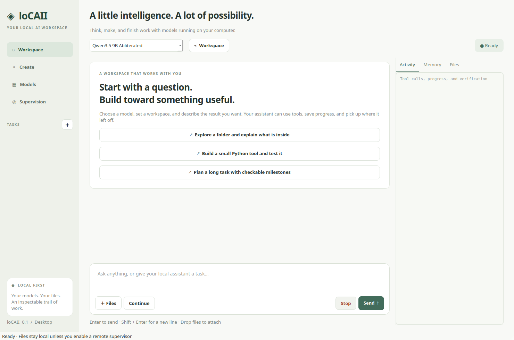

# loCAII

A modular Python/PySide6 desktop workbench for local AI: chat, documents, local file work, image/video creation, and long tasks with optional supervision.



## Start

Double-click **loCAII** on the desktop or in the applications menu. You can also open `loCAII.desktop` in this folder or run:

```bash
./launch.sh
```

This installation uses the `locaii` Conda environment. Source is under `src/locaii`; run `python -m locaii.app` from that environment in an IDE. `LOCAII_HOME` selects a different private state directory; `LOCAII_PYTHON` selects a different Python executable.

loCAII runs its own **llama.cpp** model server and talks directly to **ComfyUI**. It does not require LM Studio to be running. Existing model weights are reused from the model drive. Close or unload other GPU models before a GPU load/render; loCAII does not terminate another application's active work.

## Main workflows

1. **Workspace:** choose a folder and model, describe the task, and attach files with the Files button or drag-and-drop. Activity shows real tools, memory and errors. Continue resumes saved work; Stop cancels the current operation.
2. **Create:** select image or video, a workflow, prompt and supported sampling settings. Wan also supports a source image. Outputs have previews and clickable local files. Chat tools can generate media too.
3. **Models:** import additional GGUF weights, attach a matching vision projector, and edit model/context settings. Built-in profiles cover the existing Qwen3.5 4B/9B and Qwen3.8 27B abliterated weights. Start with 9B for more demanding tasks. The **CPU-only preset** uses 8K context and no GPU allocation when another application is using the GPU.
4. **Supervision:** choose local, manual, Codex CLI, Claude CLI, OpenAI API or Anthropic API review. Local iterations do the work; the reviewer supplies plans, checks evidence and requests another iteration when needed. Remote review is off by default.

File tools can read across the computer when enabled. Explicit attachments remain readable even when general reads are restricted to the workspace. Native writes stay within the selected workspace, retain backups and protect existing measurement/metadata files. **Optional shell commands and installed Python extensions run with your user account's permissions; native file-tool protections are not an operating-system sandbox.**

Text, PDF, DOCX and XLSX attachments have bounded extraction. Images use the model's matching vision projector. Binary formats without an extractor are identified rather than decoded as bogus text. Arbitrary PDF layouts, very large documents and model visual reasoning are not guaranteed to be interpreted correctly.

## Long-task reliability

- Complete transcripts and tool receipts are persisted in SQLite.
- Automatic Markdown memory records objectives, observations, files and next steps. Model-written summaries are fallible; incomplete summaries do not erase existing notes.
- Context compaction creates a complete private archive before adopting a measured smaller prompt. Real user instructions remain in the active context; archived messages are retrievable in bounded pages.
- Canonical full-content hashes validate resume coverage, including changes buried in large tool results.
- Interrupted native tool calls have explicit unknown outcomes. Commands with missing receipts are not blindly replayed; durable jobs can be discovered and polled.
- Empty answers and repeated tool failures have bounded recovery. Running jobs and failed commands cannot be reported as successful tool receipts.
- Terminal jobs survive a closed window, have output logs and real exit status, and support scoped cancellation. Interrupted startup is reported as an unknown outcome, and older active jobs remain discoverable.
- Media jobs are reconciled in the background after a crash. Completed output is verified; uncertain jobs are not automatically resubmitted.
- Successful read snapshots are reused only while file identity/timestamps/size match. Writes invalidate caches; metadata tools pause until new external evidence arrives.
- Slow optional memory updates time out after 60 seconds and retain observed progress. Model inference has a separate cancellable idle timeout for slow CPU prefills.

A runtime cannot guarantee that a small model reasons correctly. In particular, 4B can still invent paths or miss verification requirements. The app exposes failures and preserves evidence; use independent validation and supervision for important work.

## Configuration and extensions

Private state is normally `.local/`: tasks, SQLite database, memory, archives, model registry, workflow registry, UI settings and logs. It is excluded from Git, as are credentials, weights, generated media and the downloaded inference runtime. Development memory is in `MEMORY.md` and is also excluded.

- [Architecture and concept](CONCEPT.md)
- [Model runtime installation and configuration](docs/RUNTIME.md)
- [Media engine and custom workflows](docs/MEDIA.md)
- [Supervision, authentication and measured token overhead](docs/SUPERVISION.md)
- [Adding models, tools and workflows](docs/EXTENSIONS.md)

Model and workflow paths are editable. The defaults match this machine. Updating the runtime is explicit through `scripts/install_runtime.py`; the installer verifies the official release digest. A different compatible server binary can be supplied through `LOCAII_LLAMA_SERVER`.

To recreate the Python environment and inference runtime:

```bash
bash scripts/install.sh
python scripts/install_desktop.py
```

ComfyUI and its existing weights remain a separate local installation; its paths can be changed in Create > Render engine settings.

## Send instructions while a task runs

While a chat task is running, type in its composer and click **Send update** (or press Enter). The message is saved immediately and added to the model's next prompt at a safe boundary. You can correct a constraint, add a requirement, or ask for progress without discarding completed work.

A prediction or tool already running finishes before the update is applied. Later, undispatched tool calls from the previous plan are deferred so the model can reconsider them. **Stop** remains the control for interrupting execution. Queued messages survive interruption or restart; **Continue** applies remaining messages while preserving your unsent draft. Updates currently accept text only. New attachments can be sent once the current run finishes.

The button applies to the selected active chat, including a selected delegated task. Image/video generation and model loading cannot receive chat updates. Model, workspace and permissions remain those captured for the active run. A very late update to a successfully completed ordinary chat automatically starts another turn after its worker exits. Stopped, failed and delegated runs never restart automatically; pending instructions remain available through **Continue**.

Queued and delivered notices distinguish saved instructions from instructions added to the next prompt. Delivery is not proof that a model followed the instructions correctly; the task's observed results remain the evidence.

## Open a connected supervisor

Select your local model and workspace, then choose **Supervision → Codex CLI or Claude CLI → Open & connect supervisor**. Give the supervisor your objective in its terminal. It delegates simple to moderate work to the local model, checks observed results, and can request another iteration in the saved task. Keep loCAII open. Previous review controls are under **Advanced review settings**.

The CLI uses its existing sign-in and provider defaults. Its token usage is separate from the automatic-review allowance. See [setup, scope and real measurements](docs/SUPERVISION.md).

## Development and verification

```bash
conda activate locaii
python -m pip install -e ".[dev]"
QT_QPA_PLATFORM=offscreen python -m pytest -q
./launch.sh --screenshot assets/ui-native.png
```

The tests use synthetic files and mocked transports where appropriate. Real backend/supervisor checks are in `scripts/`; private diagnostic results are under `.local/verification`. [Verification report](docs/VERIFICATION.md) records measured outcomes and remaining limits. Run `python scripts/benchmark.py` to export the measured CSV and PNG/PDF/SVG comparison figures. A screenshot fixture labelled “Visual demo” is a visual test, not proof that its example tool operations ran.

The source repository is private at [Andrianarivelo/loCAII](https://github.com/Andrianarivelo/loCAII). Runtime binaries and dependency wheels are installed separately under their upstream licenses: [llama.cpp](https://github.com/ggml-org/llama.cpp), [Qt for Python](https://doc.qt.io/qtforpython-6/), and [ComfyUI](https://github.com/Comfy-Org/ComfyUI).
